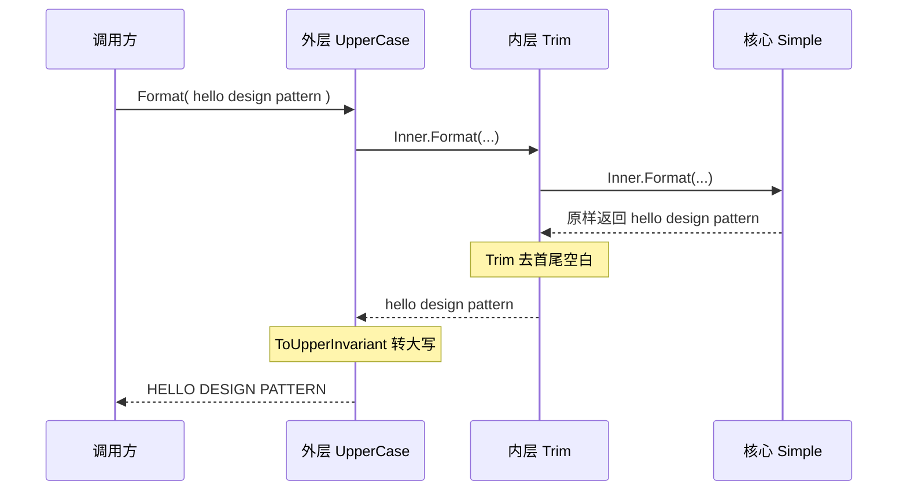

GoF 经典设计模式共 23 种，按用途分为**创建型**、**结构型**、**行为型**三大类：

- **创建型**（Creational）：如何创建对象 —— 单例、工厂、建造者
- **结构型**（Structural）：如何组合对象 —— 适配器、装饰器、代理
- **行为型**（Behavioral）：对象如何协作 —— 观察者、策略、模板方法、命令

在本文当中，只选取常用的 10 种设计模式，并使用 C＃ 编写示例代码。

## 创建型

创建型模式关注点是如何创建对象，其核心思想是要把对象的创建和使用相分离，这样使得两者能相对独立地变换。

| 模式                 | 目的                      | 举例                    |
| ------------------ | ----------------------- | --------------------- |
| **单例** (Singleton) | 全程序**只允许存在一个**实例        | 全国只有一个“中央银行”       |
| **工厂** (Factory)   | **不直接 new**，由专门的工厂决定创建谁 | 点咖啡不用管咖啡豆哪来的          |
| **建造者** (Builder)  | **分步骤**组装一个复杂对象，最后统一交付  | 组装电脑：先装 CPU、再装内存、最后验收 |

### 单例模式（Singleton）

- **核心思想**：确保一个类只有一个实例，并提供一个全局访问点
- **适用场景**：配置管理器、日志记录器、数据库连接池等

#### 标准实现

通过将类的构造函数设为私有，可以确保该类不会在外部初始化，使其在全局只有一个实例。

然后提供一个获取实例的方法，在这个方法中，将在第一次调用时初始化实例，并且为了确保在多线程中，避免多线程争抢资源，导致出现异常，这里使用双重锁的方式确保运行正常。

```csharp
public class Singleton
{
    // 私有静态实例字段
    private static  Singleton? _instance;

    // 锁对象，多线程抢创建权时用来排队
    private static readonly object _lock = new();  

    // 私有构造函数：禁止外部实例化
    private Singleton() { }

    // 获取单例实例的全局访问点
    public static Singleton Instance
    {
        get
        {
            // 第一次检查：已创建就直接返回，不碰锁
            if (_instance is null)
            {
                // 加锁，保证同一时间只有一个线程进入
                lock (_lock)
                {
                    // 第二次检查：排队等锁期间，别的线程可能已创建
                    if (_instance == null)
                    {
                        _instance = new Singleton();
                    }
                }
            }
            return _instance;
        }
    }
}
```

```csharp
// 两个变量拿到的是同一个对象
var a = Singleton.Instance;
var b = Singleton.Instance;
Console.WriteLine(ReferenceEquals(a, b));  // True：只有一个实例
```

- **单例的三个要点**：私有构造函数（禁止外部创建）、私有静态字段（藏住唯一实例）、公开静态属性（统一入口）
- **双检锁为什么检查两次？**
    - 第一次检查是为了**快**：实例一旦建好，后续的访问都不需要加锁
    - 第二次检查是为了**对**：两个线程同时通过第一次检查后，后拿到锁的线程必须发现“已经建好了”，不能再建一个

#### 优化：C＃ `Lazy<T>`

现代 .NET 中，单例交给 **依赖注入容器** 管理是最规范的做法。

若必须用静态单例，可以利用 `Lazy<T>` 来确保线程安全，并且支持延迟加载，也就是说只在第一次调用时才会初始化实例。

```csharp
public class Singleton
{
    // Lazy<T> 延迟初始化实例
    private static readonly Lazy<Singleton> _instance = 
        new(() => new Singleton());
    
    // 私有构造函数
    private Singleton() { }
    
    // 全局访问点，首次访问时才创建实例
    public static Singleton Instance => _instance.Value;
}
```

> .NET 基类库内置的 `Lazy<T>` 类型，封装了线程安全的懒加载逻辑，避免手动写双重校验锁的易错点。

### 工厂方法模式（Factory Method）

- **核心思想**：定义一个创建对象的接口，让子类决定实例化哪一个类
- **适用场景**：当系统需要处理不同类型的对象，且未来可能扩展新类型时

#### 标准实现

**场景**：文档导出功能，支持 PDF、Word。客户端说“我要一个 PDF 文档”，但不希望自己 new `PdfDocument`，免得以后文档类型越来越多，客户端代码不停地改。

```csharp
// 产品接口
public interface IDocument
{
    void Export();
}

// 具体产品 1
public class PdfDocument : IDocument
{
    public void Export() => Console.WriteLine("导出 PDF 文档");
}

// 具体产品 2
public class WordDocument : IDocument
{
    public void Export() => Console.WriteLine("导出 Word 文档");
}

// 产品类型的枚举
public enum DocType { Pdf, Word }

// 简单工厂
public class DocumentFactory
{
    // 缺点是：每新增一种文档类型，都要回来改这段代码（违反开闭原则）
    public static IDocument Create(DocType type) => type switch
    {
        DocType.Pdf  => new PdfDocument(),
        DocType.Word => new WordDocument(),
        _ => throw new ArgumentOutOfRangeException(nameof(type), type, "未知的文档类型")
    };
}
```

```csharp
// 客户端只依赖接口和工厂，完全不认识 PdfDocument 这个类
IDocument doc = DocumentFactory.Create(DocType.Pdf);
doc.Export(); // 导出 PDF 文档
```

> [!NOTE] 简单工厂 vs 工厂方法
>
> 工厂方法模式为每种产品配一个子工厂（`PdfFactory`、`WordFactory`），从而消灭 `if-else`、符合开闭原则——但类数量翻倍。日常开发中，简单工厂 + 一个 switch 往往是最划算的折中。

#### 优化：注册表工厂

**哪种类型对应哪个类**本质是张表，不该是段逻辑。把表外置成字典，新增类型就是注册一行，工厂代码就不用改：

```csharp
public static class DocumentFactory
{
    // 类型名 -> 创建方法。
    private static readonly Dictionary<string, Func<IDocument>> _creators = new()
    {
        ["pdf"]  = () => new PdfDocument(),
        ["word"] = () => new WordDocument(),
    };

    public static IDocument Create(string type) =>
        _creators.TryGetValue(type, out var creator)
            ? creator() // 查表创建，O(1)
            : throw new ArgumentOutOfRangeException(nameof(type), type, "未知的文档类型");

    // 新增产品类型时调用：
    //   ExcelFactory.Register("excel", () => new ExcelDocument());
    public static void Register(string type, Func<IDocument> creator) 
        => _creators[type] = creator;
}
```

### 建造者模式（Builder）

- **核心思想**：将一个复杂对象的构建与它的表示分离，使得同样的构建过程可以创建不同的表示。
- **适用场景**：创建包含多个可选参数的复杂对象。

#### 标准实现

**场景**：组装电脑。组装电脑的零件有很多，并且每个零件都需要复杂的工艺制造，很显然如果将所有零件的制造过程集中到一条生产线上，是不现实的，这时需要将零件单独生产，委托给不同的工厂，然后将成品的零件组装到一起。

```csharp
// 产品：电脑
public class Computer
{
    public string Cpu { get; set; } = string.Empty;
    public int RamGb { get; set; }
    public string Disk { get; set; } = string.Empty;

    public void Show() =>
        Console.WriteLine($"配置单 → CPU: {Cpu}, 内存: {RamGb}GB, 硬盘: {Disk}");
}

// 建造者：分步骤攒零件，攒够了 Build 交付
public class ComputerBuilder
{
    private readonly Computer _computer = new();

    // 关键思路：每个方法设置一个零件，然后 return this，
    // 这样才能把调用串成一条链
    public ComputerBuilder SetCpu(string cpu)
    {
        _computer.Cpu = cpu;
        return this;
    }

    public ComputerBuilder SetRam(int ramGb)
    {
        _computer.RamGb = ramGb;
        return this;
    }

    public ComputerBuilder SetDisk(string disk)
    {
        _computer.Disk = disk;
        return this;
    }

    // Build：返回成品
    public Computer Build()
    {
        return _computer;
    }
}
```

```csharp
// 采用链式调用
var pc = new ComputerBuilder()
    .SetCpu("i9-14900K")
    .SetRam(32)
    .SetDisk("2TB SSD")
    .Build();

pc.Show();
```

> [!NOTE]
> 链式调用的本质是：每个方法执行完毕后返回对象本身（`this`），从而让下一次调用可以继续在同一个对象上进行操作。

## 结构型

结构型模式主要涉及如何组合各种对象以便获得更好、更灵活的结构。

| 模式                  | 目的              | 举例               |
| :------------------ | :-------------- | :--------------- |
| **适配器** (Adapter)   | 让接口不兼容的两个类能协同工作 | 电源转换插头（国标→欧标）    |
| **装饰器** (Decorator) | 动态地给对象添加额外职责    | 奶茶加珍珠、加椰果，功能叠加   |
| **代理** (Proxy)      | 控制对某个对象的访问      | 房产中介，不直接找房东，通过中介 |

### 适配器模式（Adapter）

- **核心思想**：将一个类的接口转换成客户希望的另外一个接口，使原本不兼容的类可以协同工作。
- **适用场景**：集成第三方库、遗留系统对接。

#### 标准实现

**场景**：项目里已有一个老日志类 `OldLogger`（只能写文件），但新代码要求统一走 `ILogger` 接口，方便将来换成控制台、云日志。

```csharp
// 目标接口：客户端期望的样子
public interface ILogger
{
    void Log(string message);
}

// 被适配者：已有的老代码，不想改（或不能改，比如第三方库）
public class OldLogger
{
    public void WriteToFile(string text)
    {
        Console.WriteLine($"[写入文件] {text}");
    }
}

// 适配器：把 OldLogger 包装成 ILogger
//   采用“组合”的方式，而不是继承 OldLogger
public class LoggerAdapter : ILogger
{
    // 持有被适配对象
    private readonly OldLogger _legacy;

    public LoggerAdapter(OldLogger legacy)
    {
        _legacy = legacy;
    }

    // 把 ILogger.Log 的调用“翻译”成 OldLogger.WriteToFile
    public void Log(string message)
    {
        _legacy.WriteToFile(message);
    }
}
```

```csharp
ILogger logger = new LoggerAdapter(new OldLogger());
logger.Log("系统启动成功");   // 客户端只认识 ILogger
```

### 装饰器模式（Decorator）

- **核心思想**：动态地给一个对象添加一些额外的职责，比生成子类更为灵活。
- **适用场景**：需要在运行时动态扩展功能，如 IO 流、权限控制等。

#### 标准实现

**场景**：一个文本格式化服务，需求会变。有时候要转大写，有时候要去空白，有时候全都要，将来还可能有新花样。

```csharp
// 核心接口
public interface ITextService
{
    string Format(string text);
}

// 基础实现：原样返回
public class SimpleTextService : ITextService
{
    public string Format(string text) => text;
}

// 抽象装饰器基类：负责包装这件事本身
public abstract class TextDecorator : ITextService
{
    // 装饰器内部持有另一个 ITextService
    //  （可能是基础版，也可能是另一个装饰器）
    protected readonly ITextService Inner;

    protected TextDecorator(ITextService inner)
    {
        Inner = inner ?? throw new ArgumentNullException(nameof(inner));
    }

    public abstract string Format(string text);
}

// 具体装饰器 1：转大写
public class UpperCaseDecorator : TextDecorator
{
    public UpperCaseDecorator(ITextService inner) : base(inner) { }

    public override string Format(string text) => 
    	Inner.Format(text).ToUpperInvariant();
}

// 具体装饰器 2：去首尾空白
public class TrimDecorator : TextDecorator
{
    public TrimDecorator(ITextService inner) : base(inner) { }

    public override string Format(string text) => Inner.Format(text).Trim();
}
```

```csharp
// 像奶茶加料一样自由叠加：先去空白，再转大写
ITextService service = new UpperCaseDecorator(
    new TrimDecorator(
        new SimpleTextService()
    )
);

Console.WriteLine(service.Format("  hello design pattern  ")); 
// 输出: HELLO DESIGN PATTERN
```

- **结构像链表**：每个装饰器持有一个 `ITextService`，调用时先交给内层处理，再在自己这一层加料。
- **执行顺序像剥洋葱**：`Format` 从外到内传进去，结果从内到外返回来。



#### 优化调用：用 C# 14 扩展成员

**用 C# 14 扩展成员提供“链式加料”的流畅语法。** 配合泛型集合表达式等现代风格，组装代码可读性大幅提升：

```csharp
public static class TextServiceExtensions
{
    extension(ITextService service)
    {
        public ITextService WithUpperCase() => new UpperCaseDecorator(service);
        
        public ITextService WithTrim() => new TrimDecorator(service);
    }
}

// 组装：读起来就像一句自然语言
ITextService service = new SimpleTextService()
    .WithTrim()
    .WithUpperCase();
```

### 代理模式（Proxy）

- **核心思想**：为其他对象提供一种代理以控制对这个对象的访问。
- **适用场景**：延迟加载、权限控制、日志记录、远程调用等。

#### 标准实现

**场景**：图片加载服务，不能一开始就把所有图片加载完成，而是需要在第一次使用时才真正加载（延迟加载），并且加一道“是否登录”的访问控制。

```csharp
// 核心接口
public interface IImageLoader
{
    byte[] Load(string imageName);
}

// 真实对象：功能强大但“昂贵”（模拟 2 秒网络加载）
public class RealImageLoader : IImageLoader
{
    public byte[] Load(string imageName)
    {
        Console.WriteLine($"正在从服务器加载 {imageName} ...（耗时操作）");
        Thread.Sleep(2000);
        return new byte[] { 1, 2, 3 }; // 模拟图片数据
    }
}

// 代理：控制对真实对象的访问
public class ImageProxy : IImageLoader
{
    private readonly RealImageLoader _real = new();
    private readonly Dictionary<string, byte[]> _cache = new();

    // 模拟当前用户是否登录
    public bool IsLoggedIn { get; set; }

    public byte[] Load(string imageName)
    {
        // 1. 权限控制：没登录直接拒绝
        if (!IsLoggedIn)
            throw new InvalidOperationException("请先登录！");

        // 2. 缓存检查：已经存在就直接返回
        if (_cache.TryGetValue(imageName, out var cached))
        {
            Console.WriteLine($"从缓存返回 {imageName}");
            return cached;
        }

        // 3. 真正用到时才调用昂贵对象（延迟加载）
        var data = _real.Load(imageName);
        _cache[imageName] = data;
        return data;
    }
}
```

```csharp
var proxy = new ImageProxy();
proxy.Load("image.png");   // 抛异常：请先登录
proxy.IsLoggedIn = true;
proxy.Load("image.png");   // 第一次：真正加载（2 秒）
proxy.Load("image.png");   // 第二次：瞬间从缓存返回
```

**代理 vs 装饰器**：两者结构几乎一样（都实现同一接口 + 组合），区别在**意图**：

- 装饰器：我**多给你一些功能**（大写、压缩、加密），客户端知情且主动选择；
- 代理：我**替真实对象把门**，客户端通常不知道代理的存在。代理做的事是“控制访问”，延迟加载、缓存、权限、日志、远程调用等等。

## 行为型

行为型模式关注的是**对象之间的通信与分工**：谁通知谁、谁决定算法、流程怎么复用、请求怎么传递。

| 模式                         | 目的                     | 举例                |
| -------------------------- | ---------------------- | ----------------- |
| **观察者** (Observer)         | 一个对象的状态变化，自动通知所有关心它的人  | 订阅报纸、RSS          |
| **策略** (Strategy)          | 把一族可互换的算法封装起来，运行时自由替换  | 出行方式：地铁、打车、骑车     |
| **模板方法** (Template Method) | 流程骨架写死，具体步骤交给子类填       | 做饮料：都要烧水，加什么料各家不同 |
| **命令** (Command)           | 把“请求”封装成对象，可排队、可记录、可撤销 | 去餐厅点菜             |

### 观察者模式（Observer）

- **核心思想**：定义对象间的一种一对多依赖关系，当一个对象状态改变时，所有依赖它的对象都会收到通知并自动更新。
- **适用场景**：事件处理系统、MVVM 数据绑定、消息订阅。

#### 标准实现

**场景**：新闻发布站有新文章时，要自动通知所有订阅者（邮件用户、短信用户）。

```csharp
// 观察者接口：所有订阅者都要实现这个接口
public interface ISubscriber
{
    void Update(string news);
}

// 发布者：维护订阅名单，有新闻时挨个通知
public class NewsPublisher
{
    // 订阅名单
    private readonly List<ISubscriber> _subscribers = new();

    // 订阅
    public void Subscribe(ISubscriber subscriber)   
    {
        _subscribers.Add(subscriber);
    }

    // 退订
    public void Unsubscribe(ISubscriber subscriber) 
    {
        _subscribers.Remove(subscriber);
    }

    // 通知所有人
    private void Notify(string news)                
    {
        foreach (var subscriber in _subscribers)
            subscriber.Update(news);
    }

    // 发布内容
    public void Publish(string news)
    {
        Console.WriteLine($"[发布] {news}");
        Notify(news);
    }
}

// 具体观察者 1：邮件订阅者
public class EmailSubscriber : ISubscriber
{
    private readonly string _email;
    public EmailSubscriber(string email) => _email = email;

    public void Update(string news) =>
        Console.WriteLine($"邮件推送给 {_email}: {news}");
}

// 具体观察者 2：短信订阅者
public class SmsSubscriber : ISubscriber
{
    private readonly string _phone;
    public SmsSubscriber(string phone) => _phone = phone;

    public void Update(string news) =>
        Console.WriteLine($"短信推送给 {_phone}: {news}");
}
```

```csharp
var publisher = new NewsPublisher();
publisher.Subscribe(new EmailSubscriber("example@example.com"));
publisher.Subscribe(new SmsSubscriber("10000000000"));

// 两位订阅者同时收到
publisher.Publish("大新闻!!!");
```

**核心解耦**：发布者只依赖 `ISubscriber` 接口，完全不认识邮件、短信这些具体实现——新增一种推送方式，发布者一行代码都不用改（开闭原则）。

#### 优化：使用 C# 内置的 Event 事件机制

 C# 内置的 **event 事件机制就是为观察者模式而生的**。日常开发根本不需要自己写 `List<ISubscriber>`：

```csharp
// 事件参数
public record NewsEventArgs(string News);

public class NewsPublisher
{
    // event 关键字：外部只能 +=（订阅）/ -=（退订），
    // 不能在外部擅自触发事件或清空名单
    public event EventHandler<NewsEventArgs>? NewsPublished;

    public void Publish(string news)
    {
        Console.WriteLine($"[发布] {news}");
        // ?. 空条件调用：一个订阅者都没有时直接返回，不抛空引用异常
        NewsPublished?.Invoke(this, new NewsEventArgs(news));
    }
}
```

```csharp
var publisher = new NewsPublisher();

// lambda 就是订阅者，连类都不用写
publisher.NewsPublished += (_, e) => Console.WriteLine($"邮件推送: {e.News}");
publisher.NewsPublished += (_, e) => Console.WriteLine($"短信推送: {e.News}");

publisher.Publish("C# 14 正式发布！");
```

### 策略模式（Strategy）

- **核心思想**：定义一系列算法，把它们一个个封装起来，并且使它们可相互替换。
- **适用场景**：多种算法可互换、消除大量 if-else 条件判断。

#### 标准实现

**场景**：商场收银，折扣算法有很多种（不打折、打九折、满 100 减 20），而且经常新增。如果用 `if-else` 堆在收银台代码里，每次新增活动都要改老代码。

```csharp
// 策略接口：所有折扣算法的统一接口
public interface IDiscountStrategy
{
    decimal Apply(decimal price);
}

// 具体策略 1：不打折
public class NoDiscount : IDiscountStrategy
{
    public decimal Apply(decimal price) => price;
}

// 具体策略 2：百分比折扣（九折、八五折）
public class PercentageDiscount : IDiscountStrategy
{
    private readonly decimal _percent;

    public PercentageDiscount(decimal percent) => _percent = percent;

    public decimal Apply(decimal price) => price * (1 - _percent / 100 m);
}

// 具体策略 3：满减（满 100 减 20）
public class FullReductionDiscount : IDiscountStrategy
{
    private readonly decimal _threshold;  // 门槛
    private readonly decimal _amount;     // 减免金额

    public FullReductionDiscount(decimal threshold, decimal amount)
    {
        _threshold = threshold;
        _amount = amount;
    }

    public decimal Apply(decimal price) =>
        price >= _threshold ? price - _amount : price;
}

// 上下文：收银台。持有一个策略，结账时调用它
public class ShoppingCart
{
    // 默认不打折；可在运行时随时换掉
    private IDiscountStrategy _strategy = new NoDiscount();

    public void SetDiscount(IDiscountStrategy strategy)
    {
        _strategy = strategy;
    }

    public decimal Checkout(decimal price) => _strategy.Apply(price);
}
```

```csharp
var cart = new ShoppingCart();

// 打九折
cart.SetDiscount(new PercentageDiscount(10));
Console.WriteLine(cart.Checkout(200 m));
// 输出：180

// 换成满减
cart.SetDiscount(new FullReductionDiscount(100, 20)); 
Console.WriteLine(cart.Checkout(200 m));
// 输出：180
```

- **解决的问题**：消灭 `if (type == "九折") ... else if ...` 这样的条件分支地狱。每种算法一个类，新增算法 = 新增一个类，不碰老代码。
- **三个角色**：策略接口、一组具体策略、上下文（持有策略并调用）。
- **运行时替换**：策略可以在程序运行中切换（上例先九折后满减），这是它和简单继承最大的不同。
- **与模板方法的区别**：策略是**整体替换一个算法**；模板方法是**固定流程、替换其中几步**。

### 模板方法模式（Template Method）

- **核心思想**：定义一个操作中的流程骨架，将某些步骤延迟到子类中实现。
- **适用场景**：多个子类有共同的处理流程，但某些步骤的实现不同。

#### 标准实现

**场景**：冲咖啡和泡茶流程几乎一样：烧水 → 冲泡 → 倒进杯子 → 加调料。但冲泡什么、加什么调料各不相同。

```csharp
// 抽象基类：把流程骨架写死
public abstract class CaffeineBeverage
{
    // 模板方法：这就是“流程骨架”，用 sealed 锁死，子类不许篡改步骤顺序
    public sealed void PrepareRecipe()
    {
        BoilWater();
        Brew();
        PourInCup();
        // 钩子：子类可选择要不要加调料
        if (CustomerWantsCondiments())
            AddCondiments();
    }

    // 通用步骤：直接在基类里实现，子类无需关心
    private void BoilWater() => Console.WriteLine("烧水");
    private void PourInCup() => Console.WriteLine("倒进杯子");

    // 抽象步骤：子类必须实现（必须重写）
    protected abstract void Brew();
    protected abstract void AddCondiments();

    // 钩子方法（Hook）：基类给一个默认实现，子类"可选"覆盖
    protected virtual bool CustomerWantsCondiments() => true;
}

// 具体实现 1：咖啡
public class Coffee : CaffeineBeverage
{
    protected override void Brew() => Console.WriteLine("用沸水冲泡咖啡粉");
    protected override void AddCondiments() => Console.WriteLine("加糖和牛奶");

    // 覆盖钩子：我要喝黑咖啡，不加调料
    protected override bool CustomerWantsCondiments() => false;
}

// 具体实现 2：茶
public class Tea : CaffeineBeverage
{
    protected override void Brew() => Console.WriteLine("用沸水浸泡茶叶");
    protected override void AddCondiments() => Console.WriteLine("加柠檬");
    // 茶不覆盖钩子，默认加调料
}
```

```csharp
// 烧水 → 冲泡咖啡 → 倒杯（不加料）
new Coffee().PrepareRecipe();  
// 烧水 → 泡茶 → 倒杯 → 加柠檬
new Tea().PrepareRecipe();     
```

- **好莱坞原则**（别来找我们，我们找你）：流程骨架在基类手里，基类主动调用子类实现的方法，而不是子类调用基类。
- **三类成员要分清**：
    - 模板方法（`PrepareRecipe`）：`public sealed`，定义步骤顺序；
    - 抽象方法（`Brew`、`AddCondiments`）：子类**必须**重写；
    - 钩子方法（`CustomerWantsCondiments`）：子类**可选**重写，用来插入控制点。
- **它复用的是“流程”，策略复用的是“算法”**：一个关心步骤怎么排，一个关心算法怎么算。

### 命令模式（Command）

- **核心思想**：将一个请求封装为一个对象，从而可以使用不同的请求对客户进行参数化，支持撤销操作。
- **适用场景**：撤销/重做功能、任务队列、事务处理。

#### 标准实现

**场景**：遥控器上的按钮。按下去发生什么不该写死在遥控器里——同一个“开”按钮，今天控制灯，明天控制电视。还要求支持“撤销上一次操作”。

```csharp
// 命令接口：把“一个请求”抽象成对象
public interface ICommand
{
    void Execute();  // 执行
    void Undo();     // 撤销
}

// 接收者：真正干活的电器
public class Light
{
    public void On() => Console.WriteLine("灯亮了");
    public void Off() => Console.WriteLine("灯灭了");
}

// 具体命令：把“开灯”这个请求封装成对象
public class LightOnCommand : ICommand
{
    private readonly Light _light;
    public LightOnCommand(Light light) => _light = light;

    public void Execute() => _light.On();
    public void Undo() => _light.Off();   // 撤销 = 反向操作
}

// 具体命令：关灯
public class LightOffCommand : ICommand
{
    private readonly Light _light;
    public LightOffCommand(Light light) => _light = light;

    public void Execute() => _light.Off();
    public void Undo() => _light.On();
}

// 调用者：遥控器只认识 ICommand，完全不知道灯的存在
public class RemoteControl
{
    private ICommand? _current;
    private readonly Stack<ICommand> _undoStack = new();

    public void SetCommand(ICommand command) => _current = command;

    public void PressButton()
    {
        _current?.Execute();
        if (_current is not null)
            _undoStack.Push(_current);   // 记下历史，供撤销
    }

    public void PressUndo()
    {
        if (_undoStack.Count > 0)
            _undoStack.Pop().Undo();
    }
}
```

```csharp
var light = new Light();
var remote = new RemoteControl();

remote.SetCommand(new LightOnCommand(light));
remote.PressButton();    // 灯亮了
remote.PressUndo();      // 灯灭了 —— 撤销成功
```

- **核心解耦**：遥控器（调用者）和灯（接收者）之间隔着一层命令对象，互相不认识。想给遥控器换新功能，只需 `SetCommand` 塞一个新命令对象就行。
- **为什么值得封装成对象**：请求一旦对象化，就能排队、记录日志、定时执行、组合成宏、撤销重做——这些都是 `if` 语句做不到的。

#### 优化：C# **委托 + record**

命令只有一个 `Execute` + 一个 `Undo` 时，接口 + 一坨小类同样是样板。**委托 + record** 可以让命令轻如鸿毛：

```csharp
// record 一行定义"一条命令"：名字 + 执行动作 + 撤销动作
public sealed record Command(string Name, Action Execute, Action Undo);

public sealed class RemoteControl
{
    private readonly Stack<Command> _undoStack = new();

    public void PressButton(Command command)
    {
        Console.WriteLine($"[执行] {command.Name}");
        command.Execute();
        _undoStack.Push(command); // 入栈，记录历史
    }

    public void PressUndo()
    {
        if (_undoStack.TryPop(out var command))
        {
            Console.WriteLine($"[撤销] {command.Name}");
            command.Undo();
        }
    }
}
```

```csharp
var light = new Light();
var remote = new RemoteControl();

remote.PressButton(new Command("开灯", light.On, light.Off));
remote.PressUndo();
```

## 参考链接

- [设计模式 - Java教程 - 廖雪峰的官方网站](https://liaoxuefeng.com/books/java/design-patterns/index.html)
